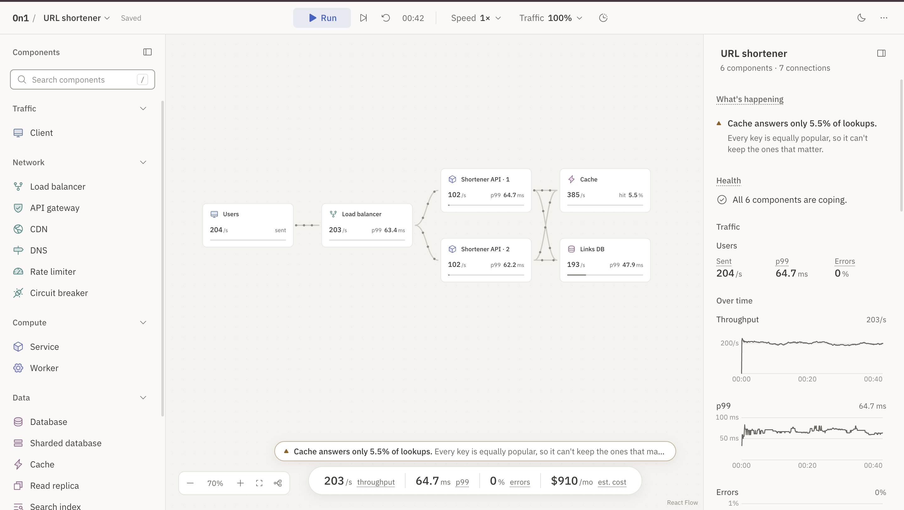

# 0n1

**Build it. Load it. Break it.**

0n1 is an open-source system design lab that runs in your browser. Drag components onto a canvas, wire them together, push traffic through, and watch where the system breaks and why.



No backend, no account, no tracking. Everything you build stays in your browser. After your first visit it works offline, and you can install it as an app.

> Early development. Things will change.

## What you can do

- **Design:** 17 components, from clients, load balancers and CDNs to services, workers, caches, databases, read replicas, queues and pub/sub. Give any of them an AWS, Azure or Google Cloud icon if you like.
- **Run it:** a simulation pushes requests through your design and shows live throughput, p99 latency and errors, for the whole system and for each part.
- **Break it:** take a component down, slow it, cut a connection, flush a cache or send a traffic surge, now or at a set time on the timeline.
- **Understand it:** plain-language notes say what's happening and why. Trace a single request through the system, and see roughly what the design would cost to run each month.
- **Learn:** five short tutorials, starting with building your first system, plus a guide that explains every number on screen.
- **Start from a blueprint:** a URL shortener, a job pipeline and a write-heavy system, each with experiments to try.
- **Keep your work:** systems save as you go. Back up your whole library to a file, and export the canvas as PNG or SVG.

Press <kbd>⌘</kbd> <kbd>K</kbd> (or <kbd>Ctrl</kbd> <kbd>K</kbd>) for the command palette.

## Run locally

You'll need [Bun](https://bun.sh) and Node.js 24 (see `.nvmrc`).

```sh
bun install
bun run dev
```

| Script | What it does |
|---|---|
| `bun run dev` | Start the dev server |
| `bun run build` | Typecheck and build static files into `dist/` |
| `bun run preview` | Serve the production build locally |
| `bun run typecheck` | Run TypeScript |
| `bun run lint` | Lint and check formatting (Biome) |
| `bun run format` | Fix formatting and lint issues where possible |
| `bun run test` | Run unit tests (Vitest) |
| `bun run test:e2e` | Run end-to-end tests (Playwright) |
| `bun run check:bundle` | After a build: fail if what the app downloads to start is over its size budget |

Before your first end-to-end run, install the browser:

```sh
bunx playwright install chromium
```

Tests in `*.build.spec.ts` (offline use, installing, updates) run against a production build, since only that has a service worker. Playwright builds it for them.

## Built with

React, TypeScript and Vite. [React Flow](https://reactflow.dev) for the canvas, uPlot for charts, Dexie over IndexedDB for storage, and Tailwind CSS. The simulation runs in a web worker.

## Contributing

Blueprints are single JSON files. [`src/blueprints/README.md`](./src/blueprints/README.md) explains the format.

The app icons in `public/` are rendered from `public/favicon.svg`. After changing it, run `bun scripts/make-icons.mjs`.

To change which vendor icons are included, put the vendors' icon packs in `vendor-icon-packs/` (git-ignored) and run `bun scripts/copy-vendor-icons.ts`.

## License

[MIT](./LICENSE), except the vendor icons in `public/vendor-icons/`. Those belong to Amazon Web Services, Microsoft and Google, are included unchanged for drawing architecture diagrams, and aren't covered by the MIT licence. See [`public/vendor-icons/NOTICE.md`](./public/vendor-icons/NOTICE.md). 0n1 isn't affiliated with any of them.
